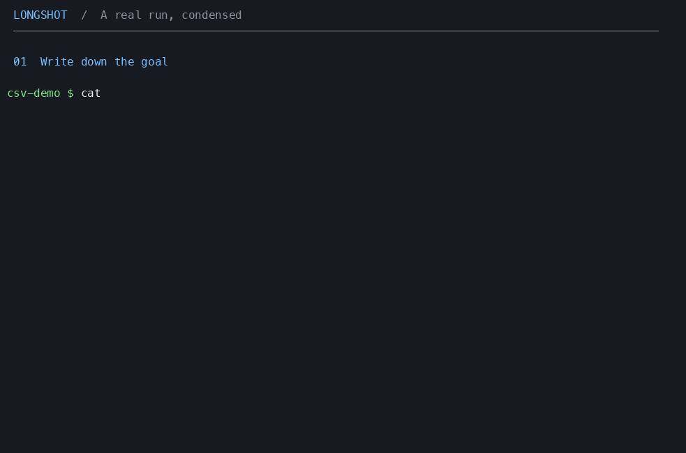

# Longshot

<p align="center">
  <a href="https://sailresearch.com"><picture><source media="(prefers-color-scheme: dark)" srcset="docs/logos/sail-dark.svg"></picture></a>
  &emsp;
  <a href="https://opencode.ai"><picture><source media="(prefers-color-scheme: dark)" srcset="docs/logos/opencode-dark.svg"></picture></a>
</p>

> [!WARNING]
> **Experimental, just a vibe-coded side project for now.** Expect rough edges and breaking changes. Keep an eye on your runs and costs.

`longshot` is a tiny CLI for starting and managing long-running, goal-based, agentic coding tasks on [Sailboxes](https://docs.sailresearch.com/sailboxes), using [Sail inference](https://sailresearch.com) and [OpenCode](https://opencode.ai) in [goal mode](https://x.com/Neriousy/status/2115790892678434965).

Running `longshot start` from a directory will start a new Sailbox, a persistent linux VM designed specifically for long-horizon agents (a sandbox that can run indefinitely). OpenCode is started in the Sailbox, configured to use Sail inference (`GLM-5.3` by default) and goal mode. OpenCode will then work on the task until it meets the specified requirements.

**One directory, one run.** Longshot keeps resource IDs in `.longshot/run.json` in the directory `longshot start` is run from. The agent runs remotely; your terminal can disconnect and re-attach later. There is no local daemon or global Longshot directory.



_Sped up for the demo._

## Install

macOS and Linux, on ARM64 or x64:

```sh
curl -fsSL https://github.com/powerset-co/longshot/releases/latest/download/install.sh | sh
```

Installs to `~/.local/bin`; run again to upgrade. You only need a **[Sail API key](https://app.sailresearch.com)**—the binary includes its runtime. Downloads are also available from [GitHub Releases](https://github.com/powerset-co/longshot/releases). Until a release is published, [build from source](#development).

## Usage

From the project directory:

```sh
export SAIL_API_KEY='your-key'
longshot start 'Build a Bun CLI that counts words in a text file.'
```

For a longer specification, use `longshot start --file GOAL.md`. Startup returns once the remote goal is confirmed.

```sh
longshot status
longshot logs
longshot message 'Prioritize the failing tests.'
longshot attach
```

Press Ctrl+C to leave `logs`, or Ctrl+X then Q to detach from OpenCode. The remote session keeps running.

When the goal is complete and execution is idle:

```sh
longshot export --output ./result
longshot destroy --yes
```

Your project is in `result/workspace`; session data and logs are in `result/session`. To finish early, run `longshot pause` and wait for execution to become idle before exporting.

**Completion and pause leave the Sailbox running.** Longshot enforces no spending or runtime limit. Monitor inference and compute charges in [Sail](https://app.sailresearch.com), then use `destroy` to stop the charges.

## Commands

| Command                                  | Purpose                                                    |
| ---------------------------------------- | ---------------------------------------------------------- |
| `start "goal"` / `start --file GOAL.md`  | Upload this directory and start a run.                     |
| `status`                                 | Show goal state, elapsed time, and recent activity.        |
| `logs`                                   | Stream new session output.                                 |
| `message "text"` / `message --file path` | Send guidance to the agent.                                |
| `attach`                                 | Open the remote OpenCode terminal UI.                      |
| `pause`                                  | Stop goal continuation; current work may finish.           |
| `resume`                                 | Resume a paused goal.                                      |
| `export --output path`                   | Download the workspace and session into a fresh directory. |
| `destroy --yes`                          | Delete this run's remote resources; keep local files.      |

Use `--directory path` (`-C`) to select a project and `--json` for scripts or coding agents. Progress and errors go to stderr; `logs --json` emits one event per line. `attach` requires a terminal and does not support `--json`. See `longshot <command> --help` for all options.

Goal mode continues until completion or pauses when it needs help, encounters an error, stalls, or reaches 50 continuation rounds. `resume` starts a fresh round allowance. `Elapsed` excludes setup, includes pauses and waiting, and freezes at completion.

## Configuration

Optional settings go in `longshot.json`:

```json
{
  "model": "zai-org/GLM-5.3",
  "window": "balanced",
  "size": "m",
  "visibility": "org",
  "env": { "CI": "true" },
  "exclude": ["**/dist", "**/.venv"]
}
```

CLI flags `--model`, `--window`, `--size`, and `--setup` override configuration. Windows are `asap`, `balanced`, or `flex`; sizes are `s`, `m`, or `l`.

The agent can install project dependencies itself. For custom preparation, set `"setup": "setup.sh"`; it runs before OpenCode starts. `env` supplies non-secret variables to both. Your local environment is not forwarded.

Visibility defaults to `org`. Use `private` with a user-scoped key to restrict access to the creator, subject to an audited admin override. See [Sail access control](https://docs.sailresearch.com/sailboxes-access-control).

## Secrets

Longshot uses a Sail Secret and egress policy to inject the inference API key into requests. The agent receives a placeholder, not the key.

For other credentials, create Sail Secrets and set `"egressPolicyFile": "egress.json"` to a [Sail egress policy](https://docs.sailresearch.com/sailboxes-credentials). Longshot adds those rules to its inference policy. Use exact hostnames other than `api.sailresearch.com`; existing secrets are not modified or deleted. Any network allowlist must also permit dependency downloads.

Secret injection applies to HTTPS requests, not environment variables. Keep secrets out of `env`, which is saved in run state and exports.

## Files and recovery

- Upload includes uncommitted and untracked files and does **not** follow `.gitignore`. It excludes `.git`, `.longshot`, `node_modules`, `.DS_Store`, and `.env`/`.env.*` files (except `.env.example`, `.env.sample`, and `.env.template`). Add exclusions in `longshot.json`.
- Export includes all workspace and session files, including caches and build output. Use a new destination and wait for background writers to finish. An interrupted export retains a `.partial` marker.
- On startup failure, use `status` or `destroy --yes`. Keep `.longshot/` until remote resources are cleaned up. Start another run in a separate directory.
- Exports can contain credentials written by the agent and session configuration; review them before sharing.

## Development

With [Bun](https://bun.sh) installed:

```sh
bun install --frozen-lockfile
bun run check
bun test
bun run build
./dist/longshot --help
```

The binary is `dist/longshot`. Build on the target OS and architecture. Use `bun run format` to format the code.

To release, update `package.json` and push the matching `v` tag. GitHub Actions builds the binaries and creates a draft release. Test the downloads and installer before publishing it.

MIT licensed.
